# Part 1. Установка OC

Чтобы узнай версию Ubuntu необходимо выполнить следующую команду:

```bash
cat cat /etc/issue
```

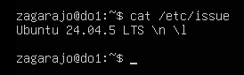

# Part 2. Создание пользователя

Команда для создания пользователя:

```bash
sudo adduser <имя_пользователя>
```
Она создаст домашний каталог, запросит пароль и другую информацию в интерактивном режиме.

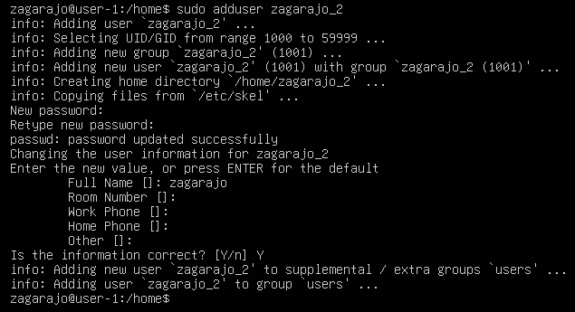

Команда для добавления пользователя в группу adm:

```bash
sudo adduser <имя_пользователя> adm
```
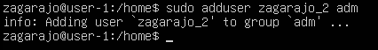

Группа adm предназначена для мониторинга системы и чтения логов. Позволяет пользователю просматривать системные журналы в /var/log (например, syslog, auth.log) без необходимости использовать sudo или su.

Для проверки необходимо использовать команду:

```bash
cat /etc/passwd
```
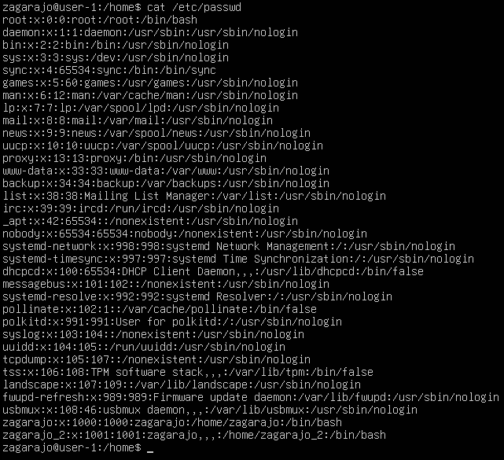

# Part 3. Настройка сети ОС

Для задания названия машины используется:

```bash
sudo hostnamectl set-hostname <новое_имя>
```
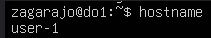

Команды изменения временной зоны:

```bash
timedatectl # проверка текущей зоны

timedatectl list-timezones # список всех зон

sudo timedatectl set-timezone Europe/Moscow # задание новой зоны
```
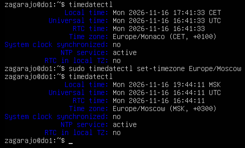

Вывод названия сетевых интерфейсов:

```bash
ip a
```
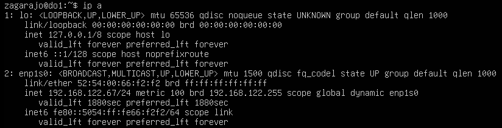

lo — это loopback-интерфейс (петлевой интерфейс). Он является виртуальным и присутствует в Linux всегда, независимо от наличия физической сетевой карты.

Назначение lo:

1. Oбеспечивает локальную сетевую связь машины с самой собой;

2. Используется для адресов 127.0.0.1 (IPv4) и ::1 (IPv6);

3. Через него работают службы, слушающие localhost;

4. Применяется для диагностики и локальных обращений к сервисам без выхода в сеть.


DHCP (Dynamic Host Configuration Protocol) - сетевой протокол, который автоматически выдаёт устройствам IP-адрес и другие параметры для работы в сети (маску подсети, шлюз по умолчанию, адреса DNS-серверов). Благодаря ему не нужно настраивать каждое устройство вручную и снижается риск конфликтов IP-адресов.

| Часть | Значение |
|---|---|
| Dynamic | динамический — адрес выдаётся автоматически и может меняться |
| Host | узел/хост — устройство в сети (компьютер, сервер, телефон) |
| Configuration | конфигурация — настройка сетевых параметров |
| Protocol | протокол — набор правил обмена данными |

Для определения и вывода внешнего ip-адрес шлюза (ip) и внутреннего IP-адрес шлюза, он же ip-адрес по умолчанию (gw), используется:

```bash
networkctl status <имя_интерфейса>
```
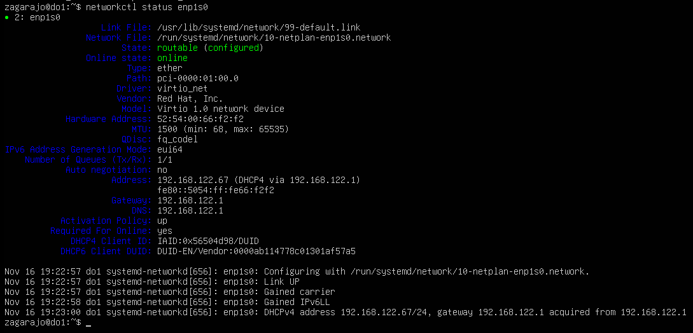

Для задания статичных настроек ip, gw, dns необходиом:

1. Найти и изменить файл конфигурации Netplan

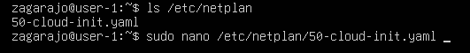

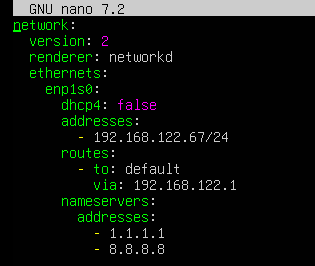

Пояснение параметров:

-dhcp4: false — отключает автоматическое получение адреса.

-addresses — статический IP-адрес с маской подсети.

routes — блок настройки маршрутизации. to: default означает маршрут по умолчанию (в интернет), а via — это адрес шлюза (gw).

nameservers — список DNS-серверов. Указали Cloudflare (1.1.1.1) и Google (8.8.8.8).

2. Применить настройки

```bash
sudo netplan try
```

3. Проверить результат после перезагрузи системы

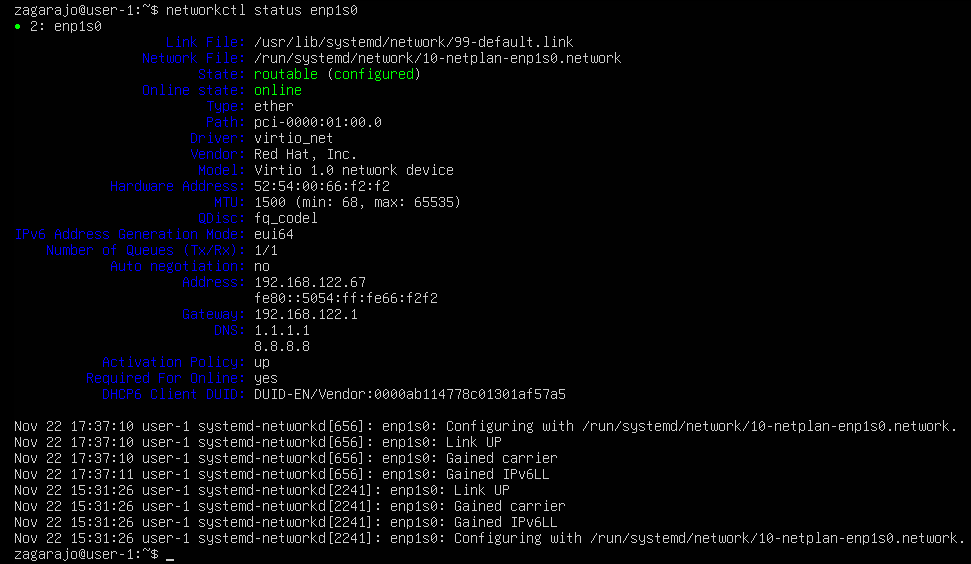

Пропинговка удаленных хостов 1.1.1.1 и ya.ru:

```bash
ping -c 4 1.1.1.1 # Проверка IP и шлюза

ping -c 4 ya.ru # Проверка DNS
```
-c — флаг (опция), который указывает утилите ping, сколько именно ICMP-пакетов (эхо-запросов) нужно отправить, прежде чем завершить работу.

4 — это значение, которое вы передали этому флагу. То есть «отправь ровно 4 пакета и остановись».

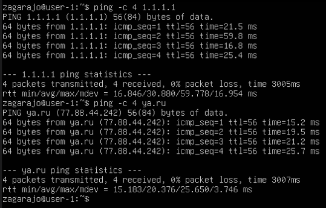

# Part 4. Обновление OC

Команда для обновления системных пакетов:

```bash
sudo apt update
```

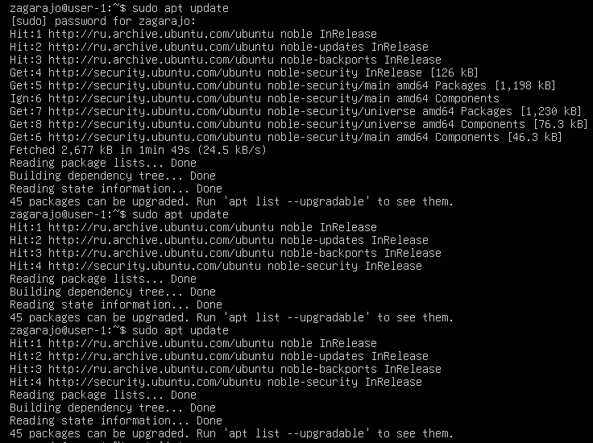

# Part 5. Использование команды sudo

Команда для наделения правами sudo:

```bash
sudo usermod -aG sudo <имя_пользователя>
```
Утилита usermod с правами администратора, добавь (-a) пользователя в список дополнительных групп (-G), не удаляя его из текущих, и помести его в группу sudo.

Команда sudo (сокращение от Superuser DO) - позволяет обычному пользователю выполнить конкретную команду с правами суперпользователя (root) или другого пользователя, не входя в систему под этой учетной записью.

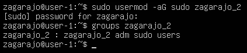

Изменение hostname от имени пользователя наделенного правами:

```bash
su - <имя_пользоватпля> # смена пользователя

sudo hostnamectl set-hostname <новое_имя> # изменение hostname

hostnamectl # проверка
```

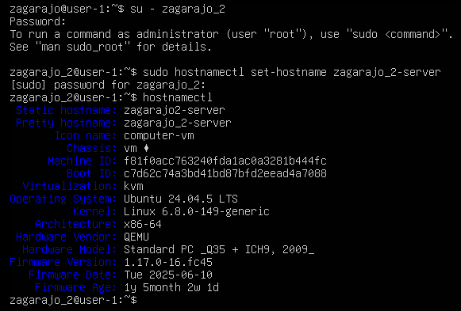

# Part 6. Установка и настройка службы времени

Команда для вывода нынешнего часового пояса:

```bash
timedatectl show
```
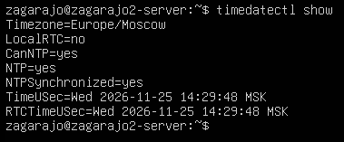

# Part 7. Установка и использование текстовых редакторов

Установка vim, nano и joe:

```bash
sudo apt install vim

sudo apt install nano

sudo apt install joe
```

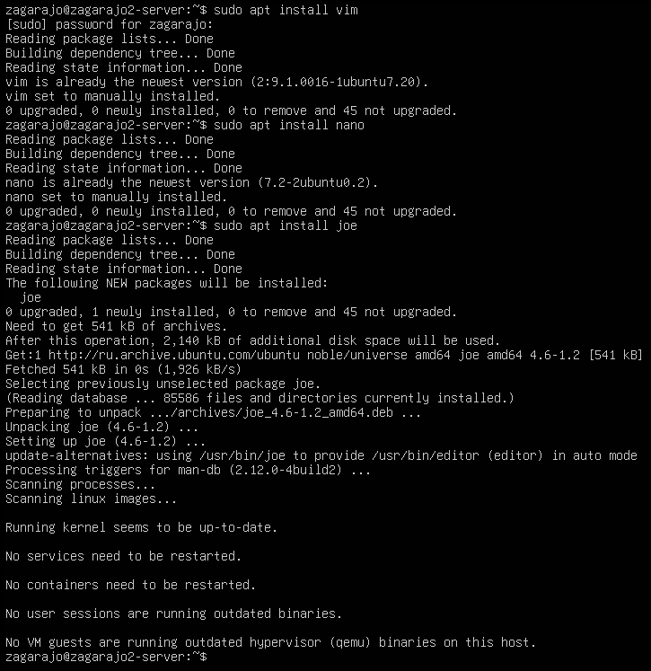

Vim и nano уже были установлены в системе по умолчанию. Пакетный менеджер просто проверил базы и убедился, что стоят самые свежие версии.

1. Vim 

Создать и открыть файл:

```bash
vim <имя_файла>.txt
```

- При нажатии i (insert) происходит переход в режим вставки(изменения файла);

- При нажатии Esc происходит возвращение в обычный режим;

- Shift + : переход в командный режим (:wq, w — write/записать, q — quit/выйти);

- Enter (подтверждение).


2. Nano

```bash
nano <имя_файла>.txt
```
- Сохранение изменений Ctrl + O (Write Out);

- Enter, чтоб подтвердить имя файла;

- Выход Cntl + X (Exit).


3. Joe

```bash
joe <имя_файла>.txt
```

- Сохронить: Ctrl + K, а затем D(Done);

- Выйти: Ctrl + K, а затем X(eXit).;


